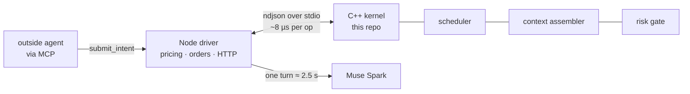
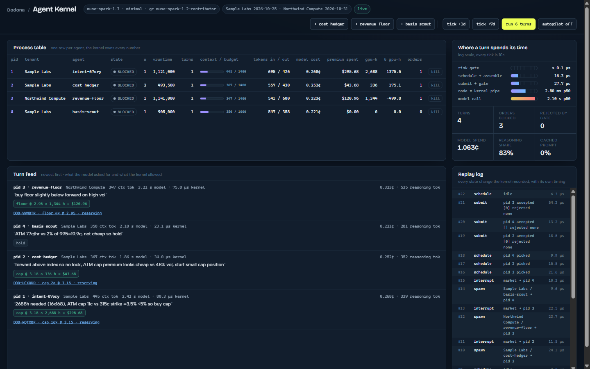

# agent-kernel

A C++20 kernel for LLM trading agents. It schedules them, pages their context into a fixed token budget, gates every order they attempt through integer-cents risk checks, and bills them per token. The language model is the CPU. The kernel is everything a CPU should not be trusted with.

Built for the Meta Global AI Developer Hackathon (Startup track) as the agent runtime behind [Dodona](https://dodona.markets), a marketplace for options on GPU compute. The model is Meta's Muse Spark via the Meta Model API.





Four agents on the console, one of them submitted by an outside MCP client. Every row is kernel state: context tokens against budget, premium spent, delta-weighted GPU-hours, orders booked. The ladder on the right puts the kernel (16 µs) and the model (2.1 s) on one log axis.

## Why a kernel

An agent that trades for a week will see thousands of events. If every event lands in its prompt, the prompt grows until the model forgets its own limits, and the bill grows with it. If the agent can call the order book directly, one hallucinated number is a real loss. The fixes are the same ones operating systems found decades ago:

| OS idea | Here | Effect |
|---|---|---|
| process control block | `Process` struct: identity, limits, exposure, usage, three tiers of memory | every agent is isolated and billable |
| fair-share scheduler | two-level virtual runtime, tenant first then process | ten agents from one customer cannot starve another customer's one |
| interrupts | market ticks, settlement events, clock | an agent with nothing new never burns a model call |
| virtual memory | context assembler with a hard token budget, newest first, dropped items counted | prompt size is flat at turn 1 and turn 100 |
| garbage collector | evicted history is summarized by a cheap second model into a working set | long memory without long prompts |
| syscall validation | eight integer checks per order: premium, GPU-hours, delta, strike band, slippage, per-turn count | the model proposes, the kernel disposes |
| audit log | bounded replay log of every state change with its own timing | replayable, benchmarkable |

## Numbers

Measured on a Snapdragon X Elite laptop, 64 processes across 8 tenants, 20,000 iterations.

| where a turn spends its time | p50 | p99 |
|---|---|---|
| risk check | < 0.1 µs | 0.1 µs |
| scheduler pick | 0.7 µs | 2.1 µs |
| assemble context | 1.7 µs | 5.2 µs |
| schedule, JSON in and out | 8.3 µs | 29.7 µs |
| submit two orders, JSON in and out | 16.1 µs | 55.9 µs |
| Node to kernel pipe round trip | 0.15 ms | 2.2 ms |
| model call, Muse Spark 1.3, minimal effort | 2.3 s | 3.4 s |

Model choice came from an evaluation on the kernel's own prompts across six Meta models and two effort settings, 144 calls. Short version: minimal effort is the only reliable setting, five of six models then agree on every decision, and the cheapest valid one costs 0.013¢ per agent turn. Full tables in [docs/MODEL-EVAL.md](docs/MODEL-EVAL.md).

The same strategy was also run for 30 simulated days as a stock LangGraph ReAct agent against the same order book, the loop TradingAgents and ai-hedge-fund are built on, with and without the kernel in front of it:

| 30 days, same model, same market | LangGraph agent, full thread | LangGraph agent, last 10 messages | kernel |
|---|---|---|---|
| largest prompt on day 30 | 16,075 tokens | 1,942 | 1,146 |
| prompt tokens sent | 845k | 153k | 33k |
| cost at list price | 24.0¢ | 16.8¢ | 8.5¢ |
| GPU-hours covered | 3,864 | 3,864 | 3,864 |

Method, caveats and the bug the benchmark found in the kernel's own feedback line are in [docs/CONTEXT-BENCH.md](docs/CONTEXT-BENCH.md).

## Build and run

Needs a C++20 compiler. No CMake, no dependencies beyond the vendored nlohmann/json header.

```sh
sh build.sh                 # kernel, tests, benchmark
./build/test_kernel.exe     # 53 checks
./build/bench.exe           # the latency table above
printf '{"id":1,"op":"spawn","tenant":"acme","name":"hedger","limits":{"max_premium_cents":50000}}\n{"id":2,"op":"ps"}\n' | ./build/kernel.exe
```

The kernel speaks newline-delimited JSON on stdin and stdout, one object per line, `id` echoed. Operations: `spawn`, `interrupt`, `schedule`, `submit`, `gc`, `kill`, `ps`, `stats`, `replay`. Every reply carries `ns`, the kernel's own timing of that call.

## Layout

```
include/   types, ring buffer, process control block, scheduler, context assembler, risk gate, kernel
src/       kernel.cpp (every operation), main.cpp (the stdio loop)
tests/     behavior tests, plain C++ with a CHECK macro
bench/     latency benchmark with p50/p90/p99
docs/      WALKTHROUGH.md (every component explained) and MODEL-EVAL.md (every model test, with raw numbers)
```

The Node driver, the console page at `/kernel`, and the MCP tools live in the Dodona platform repo on the `feature/agent-kernel` branch. [docs/WALKTHROUGH.md](docs/WALKTHROUGH.md) explains both halves.

## What it is not

It runs in userspace and touches no hardware; "kernel" is the operating-system analogy, not a claim. The CPU it schedules is probabilistic, which is the one thing a real kernel never had to design for, and the reason every instruction the model emits is validated before it can touch the world.
