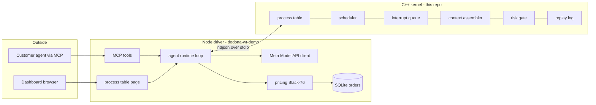
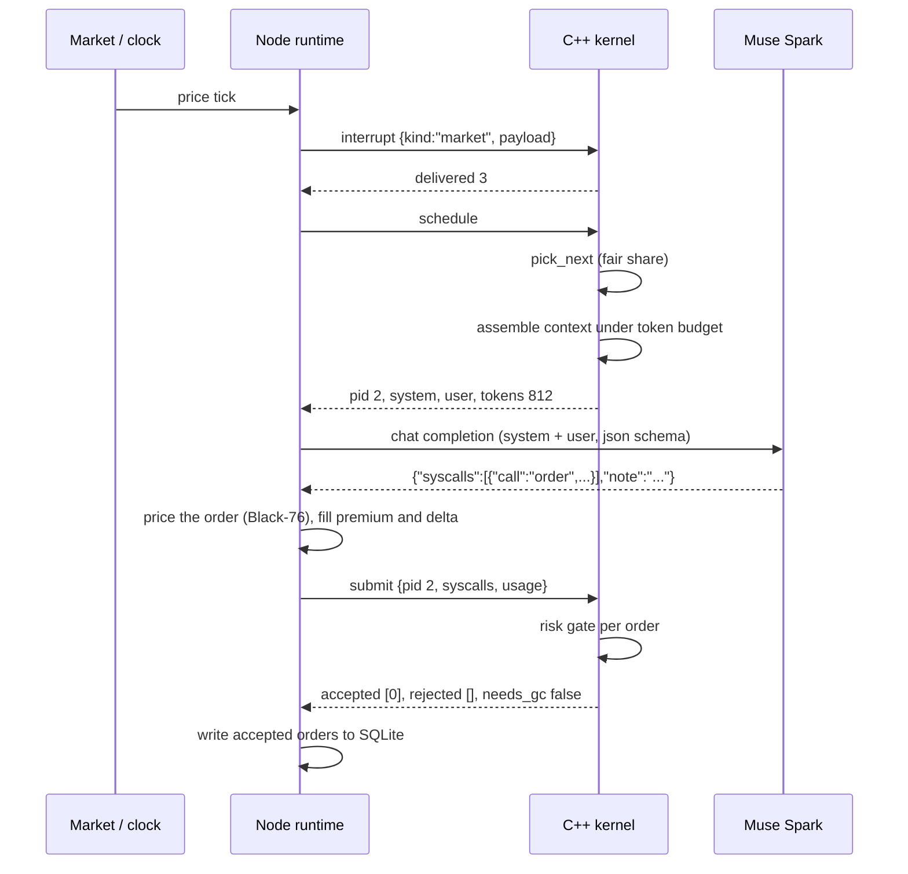

# Agent Kernel Walkthrough

This document explains the project piece by piece so you can read it later and understand every part. It grows as the build grows.

## What this is in one paragraph

Dodona is a marketplace where customers buy options on GPU compute: a **cap** protects you if the price of an hour of GPU goes up, a **floor** protects a seller if it goes down, a **lock** fixes the price. Customers do not trade by hand. They send an AI agent. This repo is the **kernel** that runs those agents. It decides which agent runs next, what the agent is allowed to see, what the agent is allowed to do, and how much it has cost. The agent's "brain" is a language model (Meta's Muse Spark). The kernel treats the model like a CPU: fast, powerful, and not to be trusted with the rules.

## The operating system analogy

| Real OS concept | What it is here | Why it exists |
|---|---|---|
| CPU | The language model | It does the thinking, one turn at a time |
| Process | One customer's agent | Each has its own memory, limits, and bill |
| Process control block (PCB) | `Process` struct in `include/pcb.hpp` | Everything the kernel knows about an agent |
| Scheduler | `pick_next` in `include/scheduler.hpp` | Decides who runs next so no customer starves |
| Interrupt | A market tick, a settlement event, a clock | Wakes an agent that was sleeping |
| Virtual memory / paging | Context assembler in `include/context.hpp` | Fits unbounded history into a fixed token budget |
| Garbage collector | Summarizer (a cheap second model call) | Compresses old history into a short "working set" |
| Syscall | `{"call":"order",...}` in the model's reply | The only way an agent can affect the world |
| Syscall validation | Risk gate in `include/risk.hpp` | Rejects orders that break the customer's limits |
| Audit log | Replay log inside `Kernel` | Every state change can be replayed |

The one thing with no OS equivalent: the CPU is probabilistic. A real CPU executes exactly what you give it. A model might hallucinate an order, ignore a limit, or answer in prose. So the kernel validates every instruction the CPU emits and budgets tokens instead of bytes.

## Architecture



The boundary is deliberate. The kernel is deterministic C++ with no network and no clock of its own, so it can be tested and benchmarked in isolation. Everything that talks to the outside world (HTTP, database, browser) lives in Node.

## One turn, step by step



Where the time goes: the kernel steps are microseconds. The model call is hundreds of milliseconds. The latency work is therefore almost entirely about the model call. See the latency section.

## Repo map

```
agent-kernel/
  build.sh                one command builds the kernel, the tests, and the benchmark
  include/
    types.hpp             integer money types, states, and the tunable constants
    ring.hpp              fixed-size ring buffer that hands back what it evicts
    pcb.hpp               Process, Limits, Exposure, Usage, Interrupt
    scheduler.hpp         pick_next and the virtual-time charge
    context.hpp           assemble: history into a fixed token budget
    risk.hpp              check_order and apply_order
    kernel.hpp            the Kernel class that owns the process table
    third_party/json.hpp  nlohmann json, vendored, MIT
  src/
    kernel.cpp            every kernel operation
    main.cpp              the ndjson loop over stdin/stdout
  tests/test_kernel.cpp   behavior tests, run as build/test_kernel.exe
  bench/bench.cpp         latency benchmark, run as build/bench.exe
  docs/                   this walkthrough and the model evaluation log
```

## The wire protocol

Node and the kernel speak newline-delimited JSON. One object per line in, one per line out. The `id` field is echoed so Node can match replies to requests.

| op | sent by Node when | kernel replies with |
|---|---|---|
| `spawn` | a customer connects | `pid` |
| `interrupt` | a tick, event, or clock fires | how many processes were woken |
| `schedule` | the runtime wants the next agent to run | `pid` plus the assembled `system` and `user` prompt, or `pid 0` if nothing is ready |
| `submit` | the model has answered | which syscalls were accepted or rejected and why, and whether gc is needed |
| `gc` | the summarizer has compressed old history | bytes stored |
| `kill` | a customer disconnects | ok |
| `ps` | the dashboard refreshes | the process table |
| `stats` | the dashboard refreshes | per-op latency counters |
| `replay` | an auditor asks | the last N state changes |

Every reply carries `ns`, the kernel's own measurement of how long that operation took.

## Component by component

### Transport (`src/main.cpp`)

Reads a line, parses it, hands it to the kernel, prints the reply, flushes. Two details matter. `std::flush` after every line: when stdout is a pipe the runtime buffers output, so without the flush Node would wait forever for a reply that is sitting in a buffer. `_setmode(..., _O_BINARY)` on Windows: otherwise the runtime rewrites `\n` as `\r\n` and the protocol is no longer "one line, one message."

### Integer money (`include/types.hpp`)

`Cents` is a 64-bit integer. Delta is in basis points. Premiums, strikes, limits: all integers. Floating point cannot represent 0.10 exactly, and a risk check that is off by a rounding error is a risk check that can be gamed. Every trading system that survives contact with an auditor does this.

### Ring buffer (`include/ring.hpp`)

A fixed array of 16 slots. When full, pushing a new entry overwrites the oldest and returns it. The kernel catches the returned entry and parks it in `evicted`, which is the queue of history waiting for the summarizer. This is how the context stays flat: history is bounded by construction, not by hoping the model stays terse.

### The process control block (`include/pcb.hpp`)

`Process` holds identity (`pid`, `tenant`, `name`), the scheduler's view (`state`, `weight`, `vruntime`), the context budget, the hard `Limits` the customer set, the running `Exposure`, the `Usage` meter, and three tiers of memory: `working_set` (a short summary, slow to change), `recent` (the ring of the last 16 things that happened), and `pending` (interrupts not yet shown to the model).

States: `Blocked` (asleep, nothing to do), `Ready` (an interrupt arrived), `Running` (its context has been handed to the model, waiting for the answer), `Terminated`.

### Scheduler (`include/scheduler.hpp`)

Two-level fair share, borrowed from Linux's CFS. Every process has a `vruntime` that grows by `tokens * 1000 / weight` each turn, and every tenant has a clock that grows by the same amount. `pick_next` chooses the Ready process whose tenant has consumed the least, breaking ties by the process that has consumed the least. The result: a tenant with ten agents cannot starve a tenant with one, and within a tenant a weight of 3 runs three times as often as a weight of 1. It is a linear scan over at most 256 processes, which is faster than a heap at that size because the data fits in cache.

### Interrupts (`op_interrupt` in `src/kernel.cpp`)

An interrupt has a kind, a payload, and a sequence number. It is delivered to one pid, one tenant, or everyone. Delivery pushes it onto the process's `pending` list and flips `Blocked` to `Ready`. That flip is the only way a process becomes runnable, so an agent with nothing new to react to never burns a model call.

### Context assembler (`include/context.hpp`)

The paging system. Given a process and a token budget it produces two strings. The **system** string is the agent's role plus its hard limits plus the response contract. It only changes when limits change, so the API can cache it (cached input is about a tenth the price). The **user** string is state, then pending interrupts newest first, then the working set, then recent history newest first.

Selection is greedy in priority order: an item is included only if it still fits. Anything that does not fit is counted in `dropped` and `truncated` is set, so the dashboard can show exactly how much history had to be left out. Token estimate is bytes divided by four, which is deliberately conservative for JSON.

### Risk gate (`include/risk.hpp`)

`check_order` runs eight checks in order and returns the first reason code that fails, or an empty string. The reason codes are short words (`max_premium`, `strike_band`, `slippage`) because they are fed back to the model next turn through `recent`, so the model learns the boundary. `apply_order` only runs on acceptance and updates `Exposure`. The pair is pure: no I/O, no allocation beyond the reason string, which is why it benchmarks in nanoseconds.

### Replay log and stats

Every mutating operation is recorded (with the large prompt text stripped) in a bounded deque. `stats` reports count, average, and max nanoseconds per operation. These are the same numbers the benchmark prints, so there is one source of truth for "how fast is the kernel."

## The Node driver (in the Dodona repo, branch `feature/agent-kernel`)

The kernel never talks to the network. Four small modules in `lib/` do, and together they turn one scheduler turn into a real order on the platform.

| File | Job | The one thing to know |
|---|---|---|
| `lib/kernel-client.mjs` | Spawns `kernel.exe`, writes one JSON line per call, matches replies by `id` | Every call has a 5 s timeout and the client restarts the kernel if it exits, so a wedged kernel can never hang the server |
| `lib/muse.mjs` | Meta Model API client | `turn()` sends the kernel's system and user frames with a strict JSON schema; `summarize()` is the garbage collector; `costMicrocents()` turns usage into money |
| `lib/agent-runtime.mjs` | The loop: `spawn`, `tick`, `run`, `finish` | `enrich()` prices each syscall with the platform's own Black-76 quote before the kernel sees it, so the risk gate checks real premiums and deltas, not the model's guesses |
| `lib/kernel-routes.mjs` | `/api/kernel/*` | The runtime starts on first use, so a server without a kernel binary or an API key still boots |

The page at `/kernel` (`kernel.html`, `kernel.js`, `kernel.css`) is the console: an htop-style process table, a log-scale latency ladder, the turn feed and the replay log, polled every 2.5 s.

### What `finish()` does, in order

1. Send the kernel's `system` and `user` strings to Muse Spark with `response_format: json_schema` so the reply can only be `{"syscalls":[...],"note":"..."}`.
2. For each `order` syscall, quote it exactly as the checkout page would (`quoteFromHistory` at the tenant's demo clock), then attach `premium_cents`, `index_cents` (the forward), `gpu_hours` and `delta_bps` (Black-76 delta times GPU-hours times 10,000).
3. `submit` to the kernel. The kernel runs the eight risk checks per order and returns `accepted` and `rejected` with reason codes.
4. Only accepted orders are booked: `createOrder` plus `recordPaid` in one SQLite transaction, which is the same path a human takes through checkout. The order then shows up on `/orders` like any other.
5. If the kernel says `needs_gc`, the summarizer folds the evicted history into a new working set and `gc` stores it.
6. Record the turn (tokens, cost, latency, decisions) for the console.

### What `tick()` does

Advances each agent tenant's demo clock through the platform's own `advance()` (so reservations confirm, windows start, settlements compute), delivers the last few fired events to that tenant's agents as `event` interrupts, then sends every agent a fresh `market` interrupt with the index, forward, volatility, the at-the-money cap premium and the lock price. Nothing runs until something wakes it.

### Results from the first live runs (2026-11-01)

| What | Measured |
|---|---|
| Kernel `schedule` including JSON in and out | 20 to 25 µs average on the live server |
| Node to kernel pipe round trip | 0.15 to 0.2 ms p50 in the demo script |
| Model call, Muse Spark 1.3 at minimal effort | 2.3 to 2.8 s p50, of which 80% of output tokens are hidden reasoning |
| Cost per agent turn | 0.25¢ on the flagship, 0.013¢ on the contributor tier |
| Context size | 350 to 650 tokens per turn against budgets of 1000 to 1400, zero dropped so far |
| Risk gate in action | Two `slippage` rejections in nine turns: the model set a limit price under the live quote and the kernel refused |

The model evaluation that chose the models is in `MODEL-EVAL.md`.

### How an outside agent gets in (MCP, hosted brain mode)

Dodona already exposes an MCP server at `/mcp`. Three tools were added in `lib/mcp-kernel.mjs`:

| Tool | What it does |
|---|---|
| `submit_intent` | Takes a plain-language goal plus hard limits (max premium, max GPU-hours, orders per turn, window). The kernel spawns a process for it. Nothing runs yet. |
| `run_agents` | Advances the demo clock, wakes every agent, runs a scheduler round through the model. |
| `agent_status` | The process-table row and the last five turns for one pid. |

The outside agent never sees a prompt, never manages a context window and never touches an order directly. It states what it wants and what it is allowed to risk; the kernel does the rest. A real MCP client did this against the running server on 2026-11-01:

```
submit_intent  goal "i run a weekly fine-tuning job on 16 h100s. cap my cost for the next
               window if a cap costs under five percent of the strike, otherwise hold."
               maxPremiumUsd 800, maxGpuHours 3000, leadDays 10, windowDays 7
            →  pid 1, limits {max_premium_cents 80000, max_gpu_hours 3000, ...}
run_agents     days 1, turns 2
            →  note "2688h needed (16x168), ATM cap 11c vs 315c strike =3.5% <5% so buy cap"
               order cap 16 × H100 @ $3.15, premium $295.68, kernel accepted, booked DOD-KQTXBF
               445 context tokens, 2.4 s model, 0.27¢
agent_status   pid 1 → state blocked, premium_spent 29568 of 80000, gpu_hours 2688 of 3000
```

The second mode in the design, bring-your-own-brain (the outside model is the CPU and the kernel only pages context and gates syscalls), is not built. It needs two tools, `wait_for_interrupt` and `submit_syscalls`, and the kernel already has every operation they would call.

### Kernel benchmark (`build/bench.exe`, 64 processes, 8 tenants, 20,000 iterations, 2026-11-01)

| operation | p50 | p90 | p99 |
|---|---|---|---|
| risk check only | < 0.1 µs | 0.1 µs | 0.1 µs |
| pick_next only | 0.7 µs | 0.8 µs | 2.1 µs |
| assemble context only | 1.7 µs | 1.8 µs | 5.2 µs |
| interrupt, JSON in and out | 7.4 µs | 9.3 µs | 24.8 µs |
| schedule, JSON in and out | 8.3 µs | 10.5 µs | 29.7 µs |
| submit two orders, JSON in and out | 16.1 µs | 19.3 µs | 55.9 µs |

The gap between the "only" rows and the JSON rows is the cost of the wire format, about 7 µs per message to parse and serialize. It is the largest cost inside the kernel and still three hundred thousand times smaller than one model call. The first benchmark run exposed a real bug: without a cap on parked evictions, submit grew to 90 µs because every reply copied an ever-growing list. Bounding it (`EVICTED_MAX`) fixed both the number and the design.

## Latency: where it goes and how to lower it

| Stage | Typical cost | Lever |
|---|---|---|
| Node to kernel pipe round trip | ~50 µs | already negligible |
| Kernel schedule + assemble | see benchmark | preallocated, cache-friendly, integer math |
| Kernel risk gate | see benchmark | pure function, no allocation |
| HTTPS to Meta API | 100-300 ms network + queue | keep-alive connection reuse, parallel calls across agents |
| Model reasoning | 200-800 ms | `reasoning_effort: minimal`, small `max_completion_tokens` |
| Model output | ~20 ms per 10 tokens | structured output with a tight schema, no prose |
| Prompt size | pay per token | stable system prefix for caching, hard token budget |

The honest summary: the kernel is three to four orders of magnitude faster than the model, so the kernel's job is to never be the bottleneck and to make the model call as small as possible. The model evaluation log records which model and effort setting gives the lowest latency and cost that still produces valid syscalls.

## Testing approach

Tests are plain C++ with a `CHECK` macro, built by `build.sh` and run as `build/test_kernel.exe`. GoogleTest and CMake were skipped because neither is installed on this ARM64 Windows laptop and the hackathon deadline did not allow for toolchain work. The tests cover: the ring buffer, spawn and lifecycle, every risk-gate reason code, tenant fair share and weights, the context budget staying flat over 60 turns, the gc cycle, and replay/stats.

## How to run

```sh
sh build.sh
./build/test_kernel.exe
./build/bench.exe
printf '{"id":1,"op":"spawn","tenant":"acme","name":"hedger","limits":{"max_premium_cents":50000}}\n{"id":2,"op":"ps"}\n' | ./build/kernel.exe
```

## Glossary

- **cap / floor / lock**: call option, put option, and fixed-price forward on GPU hours.
- **premium**: what you pay for the option, in cents.
- **strike**: the price level the option protects.
- **delta**: how much the option's value moves when the underlying moves, in basis points.
- **tenant**: one customer; may own many agents.
- **vruntime**: virtual runtime, the scheduler's fairness counter.
- **working set**: the short summary of everything the agent has done that no longer fits in recent history.
- **gc**: garbage collection, here meaning summarization of evicted history.
